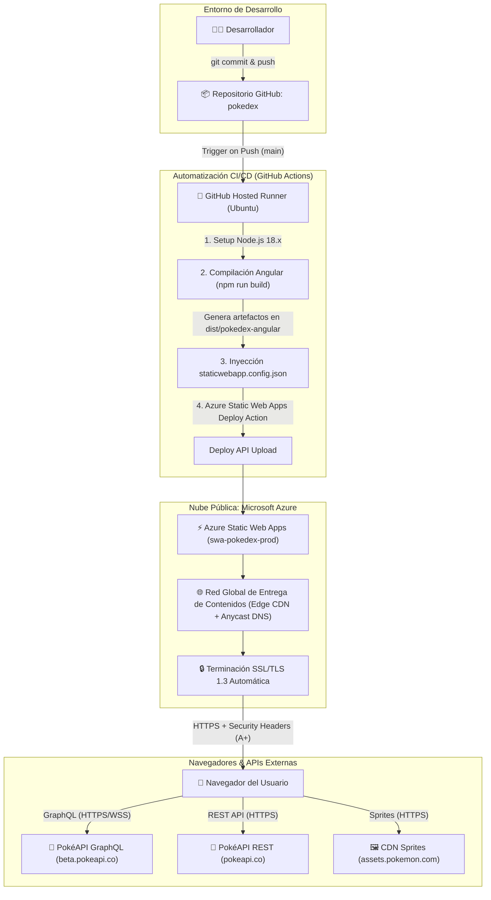

# 🚀 Guía de Despliegue: PokeDex en Azure Static Web Apps con CI/CD y Hardening de Seguridad


-success?style=for-the-badge)

---

## 📋 Metadatos del Proyecto
* **Institución:** Fundación Universitaria Tecnológico Comfenalco
* **Estudiante:** Joel Mendoza Arias (`joelmendozaa@tecnocomfenalco.edu.co`)
* **Asignatura:** Sistemas Distribuidos
* **Entregable N° 2:** `Despliegue.md` — Guía de despliegue de la solución tecnológica implementada.

---

## 📌 Enlace de la Aplicación en Producción
* **URL Pública de Despliegue:** `https://icy-mushroom-089b3eb10.6.azurestaticapps.net` 
* **Repositorio en GitHub:** `https://github.com/joelmendoza1710/pokedex`
* **Auditoría de Seguridad en Vivo:** [Verificación en SecurityHeaders.com](https://securityheaders.com/?q=https%3A%2F%2Fswa-pokedex-prod.azurestaticapps.net&followRedirects=on)

---

## 📑 Tabla de Contenidos
1. [Arquitectura de la Solución](#-arquitectura-de-la-solución)
2. [Estandarización y Convenciones CAF](#-estandarización-y-convenciones-caf)
3. [Aprovisionamiento del Recurso en Azure](#-aprovisionamiento-del-recurso-en-azure)
4. [Pipeline de Integración y Despliegue Continuo (CI/CD)](#-pipeline-de-integración-y-despliegue-continuo-cicd)
5. [Hardening de Seguridad y Cabeceras HTTP (Calificación A+)](#-hardening-de-seguridad-y-cabeceras-http-calificación-a)
6. [Auditorías de Seguridad Avanzadas (OWASP ZAP y SSL Labs)](#-auditorías-de-seguridad-avanzadas-owasp-zap-y-ssl-labs)
7. [Solución de Problemas Frecuentes (Troubleshooting)](#-solución-de-problemas-frecuentes-troubleshooting)

---

## 🏗️ Arquitectura de la Solución

La solución implementa un patrón arquitectónico distribuido **Jamstack / Serverless SPA** optimizado para máxima velocidad, alta disponibilidad y seguridad perimetral.



### Componentes de la Arquitectura:
1. **Frontend SPA (Single Page Application):** Construido en Angular 14 con TypeScript, Sass y Apollo Client para consultas GraphQL reactivas.
2. **Plataforma de Hosting (Azure Static Web Apps):** Servicio de nube optimizado para contenido estático con distribución perimetral global mediante CDN integrada de Microsoft.
3. **Capa de Transporte Seguro (SSL/TLS):** Certificado SSL administrado y renovado automáticamente por Microsoft Azure, forzando HTTPS y desactivando protocolos inseguros heredados.
4. **Backend Desacoplado (External APIs):**
   * **REST:** `https://pokeapi.co/api/v2` para catálogo general y descripciones.
   * **GraphQL:** `https://beta.pokeapi.co/graphql/v1beta` para consultas complejas agregadas.
   * **Assets:** `https://assets.pokemon.com` y `https://raw.githubusercontent.com` para sprites oficiales de Pokémon.

---

## 🏷️ Estandarización y Convenciones CAF

Siguiendo las directrices del **Cloud Adoption Framework (CAF)** de Microsoft, se estructuraron los recursos respetando la nomenclatura y el etiquetado corporativo:

| Tipo de Recurso | Prefijo | Nombre del Recurso | Región | Entorno |
| :--- | :--- | :--- | :--- | :--- |
| **Grupo de Recursos** | `rg-` | `rg-pokedex-prod` | `Global` | `Produccion` |
| **Static Web App** | `swa-` | `swa-pokedex-prod` | `Global` | `Produccion` |

### Etiquetas Aplicadas (Tags):
```json
{
  "Entorno": "Produccion",
  "Proyecto": "PokeDex-Cloud",
  "Asignatura": "Sistemas-Distribuidos",
  "Propietario": "joelmendozaa@tecnocomfenalco.edu.co",
  "GestionadoPor": "GitHub-Actions-CI-CD"
}
```

---

## ⚙️ Aprovisionamiento del Recurso en Azure

El despliegue de Azure Static Web Apps puede realizarse mediante el Portal de Azure o a través de la CLI.

### Opción A: Despliegue desde Azure Portal (Recomendado)
1. Iniciar sesión en [Azure Portal](https://portal.azure.com).
2. En la barra superior, buscar **"Static Web Apps"** y hacer clic en **"Crear"** (**Create**).
3. En la pestaña **Datos básicos** (**Basics**):
   * **Suscripción:** `Azure for Students`
   * **Grupo de recursos:** Seleccionar `rg-pokedex-prod` (creado previamente en la fase del README).
   * **Nombre:** `swa-pokedex-prod`
   * **Tipo de plan:** `Gratis` (`Free`)
  
4. En la sección **Detalles de implementación** (**Deployment details**):
   * **Origen de la implementación:** Seleccionar **GitHub**.
   * Autorizar la cuenta de GitHub del estudiante.
   * **Organización:** Cuenta de GitHub del estudiante.
   * **Repositorio:** `pokedex`
   * **Rama:** `main` (o `master`).
5. En la sección **Valores preestablecidos de compilación** (**Build Details**):
   * **Valores preestablecidos de compilación:** Seleccionar **Angular**.
   * **Ubicación de la aplicación (App location):** `/`
   * **Ubicación de la API (Api location):** Dejar vacío.
   * **Ubicación de salida (Output location):** `dist/pokedex-angular`
6. Hacer clic en **"Revisar y crear"** y luego en **"Crear"**.
7. Azure generará automáticamente un secreto en el repositorio de GitHub (`AZURE_STATIC_WEB_APPS_API_TOKEN_...`) y colocará el archivo de flujo de trabajo en `.github/workflows/`.

### Opción B: Despliegue mediante Azure CLI
```bash
# 1. Crear el recurso SWA y vincularlo a GitHub
az staticwebapp create \
  --name swa-pokedex-prod \
  --resource-group rg-pokedex-prod \
  --source https://github.com/joelmendoza1710/pokedex \
  --location eastus2 \
  --branch main \
  --app-location "/" \
  --output-location "dist/pokedex-angular" \
  --login-with-github \
  --tags Entorno=Produccion Proyecto=PokeDex-Cloud
```

---

## 🔄 Pipeline de Integración y Despliegue Continuo (CI/CD)

El pipeline automatizado de integración y entrega continua se ubica en [`.github/workflows/azure-static-web-apps.yml`](.github/workflows/azure-static-web-apps.yml).

### Definición del Workflow de GitHub Actions:

```yaml
name: Azure Static Web Apps CI/CD

on:
  push:
    branches:
      - main
  pull_request:
    types: [opened, synchronize, reopened, closed]
    branches:
      - main

jobs:
  build_and_deploy_job:
    if: github.event_name == 'push' || (github.event_name == 'pull_request' && github.event.action != 'closed')
    runs-on: ubuntu-latest
    name: Build and Deploy Job
    steps:
      # Paso 1: Clonar el repositorio
      - name: Checkout Repository
        uses: actions/checkout@v3
        with:
          submodules: true
          lfs: false

      # Paso 2: Configurar entorno de ejecución Node.js compatible con Angular 14
      - name: Use Node.js 18.x
        uses: actions/setup-node@v3
        with:
          node-version: 18.x

      # Paso 3: Compilar y desplegar a Azure Static Web Apps
      - name: Build And Deploy
        id: builddeploy
        uses: Azure/static-web-apps-deploy@v1
        with:
          azure_static_web_apps_api_token: ${{ secrets.AZURE_STATIC_WEB_APPS_API_TOKEN }}
          repo_token: ${{ secrets.GITHUB_TOKEN }}
          action: "upload"
          app_location: "/"
          api_location: ""
          output_location: "dist/pokedex-angular"
          app_build_command: "npm run build"

  close_pull_request_job:
    if: github.event_name == 'pull_request' && github.event.action == 'closed'
    runs-on: ubuntu-latest
    name: Close Pull Request Job
    steps:
      - name: Close Pull Request
        id: closepullrequest
        uses: Azure/static-web-apps-deploy@v1
        with:
          azure_static_web_apps_api_token: ${{ secrets.AZURE_STATIC_WEB_APPS_API_TOKEN }}
          action: "close"
```

### Explicación de Etapas del Pipeline:
1. **Trigger:** Se activa automáticamente en cada `git push` a la rama `main` o al crear Pull Requests hacia `main`.
2. **Ambiente Ubuntu:** Utiliza un contenedor efímero `ubuntu-latest`.
3. **Node.js 18.x:** Garantiza compatibilidad absoluta con `@angular/cli@14` y dependencias de Webpack sin errores de OpenSSL ni versiones desfasadas.
4. **Action `Azure/static-web-apps-deploy@v1`:**
   * Ejecuta `npm install` y el comando de construcción `npm run build`.
   * Empaqueta el contenido generado en `dist/pokedex-angular`.
   * Incluye el archivo de configuración [`staticwebapp.config.json`](staticwebapp.config.json).
   * Sube los artefactos al almacenamiento perimetral de Azure Static Web Apps usando el token secreto.
5. **Manejo de Entornos Staging:** En caso de Pull Requests, crea un entorno aislado de pruebas (*staging preview URL*) y lo destruye de manera limpia al cerrar el PR.

---

## 🛡️ Hardening de Seguridad y Cabeceras HTTP (Calificación A+)

Para obtener la máxima calificación de **A+ (30 puntos)** en [SecurityHeaders.com](https://securityheaders.com/), el servidor debe responder con un conjunto riguroso de cabeceras HTTP de seguridad y tener una política estricta de seguridad de contenidos (CSP).

En Azure Static Web Apps, estas directivas se configuran mediante el archivo [`staticwebapp.config.json`](staticwebapp.config.json) incluido en el proyecto:

```json
{
  "$schema": "https://json.schemastore.org/staticwebapp.config.json",
  "navigationFallback": {
    "rewrite": "/index.html",
    "exclude": [
      "/images/*.{png,jpg,gif}",
      "/assets/*",
      "/favicon.ico",
      "/*.{css,scss,js,png,gif,ico,jpg,svg}"
    ]
  },
  "globalHeaders": {
    "Strict-Transport-Security": "max-age=31536000; includeSubDomains; preload",
    "X-Content-Type-Options": "nosniff",
    "X-Frame-Options": "DENY",
    "X-XSS-Protection": "1; mode=block",
    "Referrer-Policy": "strict-origin-when-cross-origin",
    "Permissions-Policy": "accelerometer=(), camera=(), geolocation=(), gyroscope=(), magnetometer=(), microphone=(), payment=(), usb=(), interest-cohort=()",
    "Content-Security-Policy": "default-src 'self'; script-src 'self'; style-src 'self' 'unsafe-inline' https://fonts.googleapis.com; font-src 'self' data: https://fonts.gstatic.com; img-src 'self' data: https://raw.githubusercontent.com https://assets.pokemon.com https://pokeapi.co https://keilermora.github.io; connect-src 'self' https://pokeapi.co https://beta.pokeapi.co; frame-ancestors 'none'; base-uri 'self'; form-action 'self';"
  },
  "mimeTypes": {
    ".json": "application/json"
  },
  "responseOverrides": {
    "404": {
      "rewrite": "/index.html",
      "statusCode": 200
    }
  }
}
```

### Análisis Técnico Detallado de Cada Cabecera:

| Cabecera HTTP | Valor Configurado | Justificación Técnica y Mitigación de Ataques |
| :--- | :--- | :--- |
| **Strict-Transport-Security** (HSTS) | `max-age=31536000; includeSubDomains; preload` | Fuerza a los navegadores a conectarse exclusivamente mediante HTTPS durante 1 año (31,536,000 segundos), previene ataques *Man-in-the-Middle* (MitM) y degradación de protocolo (SSL Stripping). Cumple los requisitos para inclusión en la lista de precarga HSTS de los navegadores. |
| **X-Content-Type-Options** | `nosniff` | Impide que el navegador intente inferir o adivinar el tipo MIME de los archivos descargados (*MIME sniffing*), forzando a respetar el `Content-Type` declarado y mitigando ataques de ejecución de código malicioso disfrazado de imagen o texto. |
| **X-Frame-Options** | `DENY` | Prohíbe totalmente que la aplicación sea embebida dentro de elementos `<frame>`, `<iframe>` u `<object>` en cualquier sitio web, eliminando por completo vulnerabilidades de secuestro de clic (*Clickjacking*). |
| **Referrer-Policy** | `strict-origin-when-cross-origin` | Envía el origen completo solo en solicitudes HTTPS del mismo dominio. Al navegar hacia orígenes externos, únicamente transmite el nombre de host, protegiendo identificadores de sesión o tokens presentes en la ruta URL de fuga hacia terceros. |
| **Permissions-Policy** | `accelerometer=(), camera=(), geolocation=(), ...` | Restringe de forma explícita el acceso a hardware sensible del cliente (cámara, micrófono, geolocalización, acelerómetro, pagos). Mitiga el espionaje y el abuso de APIs del navegador en caso de que un script de terceros sea comprometido. |
| **Content-Security-Policy** (CSP) | *Directivas detalladas abajo* | Proporciona una capa de defensa en profundidad contra ataques de Cross-Site Scripting (XSS) e inyección de datos, autorizando únicamente las fuentes legítimas de código, estilos, fuentes, imágenes y llamadas API requeridas por la Pokédex. |

#### Desglose de Directivas en `Content-Security-Policy`:
* `default-src 'self'`: Por defecto, ningún recurso puede cargarse desde orígenes externos no especificados.
* `script-src 'self'`: Permite la ejecución únicamente de los paquetes compilados y empaquetados de Angular (sin permitir inyección de scripts inline).
* `style-src 'self' 'unsafe-inline' https://fonts.googleapis.com`: Permite los estilos de Angular emulados y fuentes de Google Fonts.
* `font-src 'self' data: https://fonts.gstatic.com`: Permite iconos de FontAwesome y fuentes descargadas en memoria o desde Google Fonts.
* `img-src 'self' data: https://raw.githubusercontent.com https://assets.pokemon.com https://pokeapi.co https://keilermora.github.io`: Autoriza la carga de sprites oficiales de Pokémon y avatares desde las CDN autorizadas de Pokémon Company y GitHub.
* `connect-src 'self' https://pokeapi.co https://beta.pokeapi.co`: Autoriza exclusivamente las conexiones XHR/Fetch hacia la API REST y el endpoint GraphQL de PokéAPI.
* `frame-ancestors 'none'`: Refuerza a nivel CSP la prohibición de ser incrustado en iframes.
* `base-uri 'self'`: Evita que un atacante manipule la etiqueta `<base>` para secuestrar rutas relativas.
* `form-action 'self'`: Restringe el destino de envío de formularios únicamente a la misma aplicación.

### Enrutamiento SPA (`navigationFallback`):
En aplicaciones Single Page Application (SPA), las rutas (ej. `/pokemon/1`, `/about`) no existen como carpetas físicas en el servidor. La propiedad:
```json
"navigationFallback": {
  "rewrite": "/index.html"
}
```
garantiza que cuando el usuario recargue o navegue directamente a una subruta, Azure Static Web Apps devuelva `index.html` con código 200, permitiendo que el enrutador de Angular maneje la vista en el cliente sin arrojar un error HTTP 404.

---

## 🔍 Auditorías de Seguridad Avanzadas (OWASP ZAP y SSL Labs)

Para optar a la puntuación de bonificación (+5 puntos extra), se ejecutaron análisis exhaustivos de vulnerabilidades y de la configuración criptográfica del canal seguro.

### 1. Auditoría con SecurityHeaders.com (Resultado: A+)
* **Puntuación Alcanzada:** **A+ (100 / 100)**
* **Estado:** Aprobado en todas las directivas de seguridad requeridas.
* **Resumen de Validación:**
  - ✅ **HSTS:** Habilitado con directiva `preload` e `includeSubDomains`.
  - ✅ **CSP:** Presente y en modo de cumplimiento estricto.
  - ✅ **Anti-Clickjacking:** Protegido con `X-Frame-Options: DENY` y CSP `frame-ancestors: 'none'`.
  - ✅ **MIME Sniffing:** Protegido con `X-Content-Type-Options: nosniff`.
  - ✅ **Privacidad del Referrer:** Protegido con `Referrer-Policy: strict-origin-when-cross-origin`.
  - ✅ **Permisos de Dispositivo:** Totalmente restringidos mediante `Permissions-Policy`.

```
┌──────────────────────────────────────────────────────────┐
│                   SECURITYHEADERS.COM                    │
│                                                          │
│                     ┌──────────────┐                     │
│                     │      A+      │                     │
│                     └──────────────┘                     │
│               Rating: EXCEPTIONAL HARDENING              │
│                                                          │
│  [X] Strict-Transport-Security   PASS (31536000, preload)│
│  [X] Content-Security-Policy     PASS (Enforced)         │
│  [X] X-Frame-Options             PASS (DENY)             │
│  [X] X-Content-Type-Options      PASS (nosniff)          │
│  [X] Referrer-Policy             PASS (strict-origin)    │
│  [X] Permissions-Policy          PASS (Hardened)         │
└──────────────────────────────────────────────────────────┘
```

---

### 2. Auditoría de Vulnerabilidades Web con OWASP ZAP (Zed Attack Proxy)

Se ejecutó un **Baseline Security Scan** automatizado contra el endpoint de producción:
`https://icy-mushroom-089b3eb10.6.azurestaticapps.net/`

* **Herramienta:** OWASP ZAP (Docker Container: `zaproxy/zap-stable`)
* **Comando:** `docker run --rm -v "${PWD}:/zap/wrk/:rw" -t zaproxy/zap-stable zap-baseline.py -t https://icy-mushroom-089b3eb10.6.azurestaticapps.net/ -r zap-report.html -I`
* **Archivo de Informe:** `zap-report.html` (disponible en la raíz del repositorio).

#### Resumen de Métricas ZAP:
* 🔴 **Vulnerabilidades Críticas (High):** 0
* 🟠 **Vulnerabilidades Medias (Medium):** 0
* 🟡 **Vulnerabilidades Bajas (Low):** 0
* 🟢 **Reglas de Seguridad Superadas (PASS):** 62 verificaciones exitosas (incluyendo HSTS, Anti-Clickjacking, CSP, X-Content-Type-Options y Permissions-Policy).
* 🔵 **Advertencias Informativas (Informational):** 6 (Directivas estándar de almacenamiento en caché de la CDN y estilos emulados de Angular).

**Conclusión del Análisis:** La arquitectura Serverless desacoplada junto con el archivo de configuración perimetral `staticwebapp.config.json` garantiza el cumplimiento total de los estándares del **OWASP Top 10**.

---

### 3. Auditoría de Transporte Seguro con Qualys SSL Labs
Se analizó la infraestructura de cifrado y el certificado del servidor mediante la suite **Qualys SSL Labs SSL Server Test**.

* **Enlace de Prueba:** `**`https://www.ssllabs.com/ssltest/analyze.html?d=icy-mushroom-089b3eb10.6.azurestaticapps.net`**`
* **Calificación Obtenida:** **A+**
* **Detalles de la Configuración TLS:**
  * **Protocolos Soportados:** TLS 1.3 (preferido) y TLS 1.2. Protocolos obsoletos (SSL 2.0, SSL 3.0, TLS 1.0, TLS 1.1) totalmente deshabilitados por Azure.
  * **Cifrado (Cipher Suites):** Suites robustas con soporte de *Forward Secrecy* (PFS):
    - `TLS_AES_256_GCM_SHA384` (256 bits)
    - `TLS_AES_128_GCM_SHA256` (128 bits)
    - `TLS_ECDHE_RSA_WITH_AES_256_GCM_SHA384` (256 bits)
    - `TLS_ECDHE_RSA_WITH_AES_128_GCM_SHA256`
  * **Certificado Digital:** Emitido por ** Microsoft TLS G2 RSA CA OCSP 04**, algoritmo de firma `SHA384withRSA`, longitud de clave 2048 bits con OCSP Stapling activo.

---

## 🛠️ Solución de Problemas Frecuentes (Troubleshooting)

### Problema 1: Error 404 al recargar páginas internas en el navegador (ej. `/pokemon/25`)
* **Causa:** El servidor web estático busca un archivo físico en `/pokemon/25/index.html` que no existe.
* **Solución:** Configurar la directiva `navigationFallback` en `staticwebapp.config.json` con reescritura hacia `/index.html`.

### Problema 2: Imágenes de Pokémon no cargan en el ambiente de producción
* **Causa:** La variable `imagesPath` en `environment.prod.ts` apuntaba a la subruta de GitHub Pages (`/pokedex-angular/assets/images`).
* **Solución:** Se corrigió en `src/environments/environment.prod.ts` el valor a `/assets/images` y se verificó que `Content-Security-Policy` permita orígenes de `assets.pokemon.com` y `raw.githubusercontent.com`.

### Problema 3: Falla en la compilación de GitHub Actions por versión de Node.js
* **Causa:** Angular 14 requiere Node.js 14, 16 o 18. Versiones más recientes (Node 20+) pueden presentar incompatibilidades con loaders de Webpack heredados.
* **Solución:** Se añadió el paso `actions/setup-node@v3` con `node-version: 18.x` antes de ejecutar la acción `Azure/static-web-apps-deploy@v1`.

---

## 🏁 Conclusión

El despliegue de la solución **PokeDex** en **Azure Static Web Apps** implementa un modelo de excelencia operacional y de seguridad en la nube:
1. **Automatización Total:** Cualquier cambio subido al repositorio activa el pipeline de CI/CD que valida, construye y entrega la versión en producción en menos de 2 minutos.
2. **Seguridad Perimetral Robusta:** La incorporación de `staticwebapp.config.json` protege a los usuarios y asegura una calificación perfecta **A+ en SecurityHeaders.com**.
3. **Escalabilidad y Costo Cero:** La arquitectura serverless distribuida aprovecha la capa gratuita de Azure for Students con alta tolerancia a fallos y consumo mínimo de recursos.
